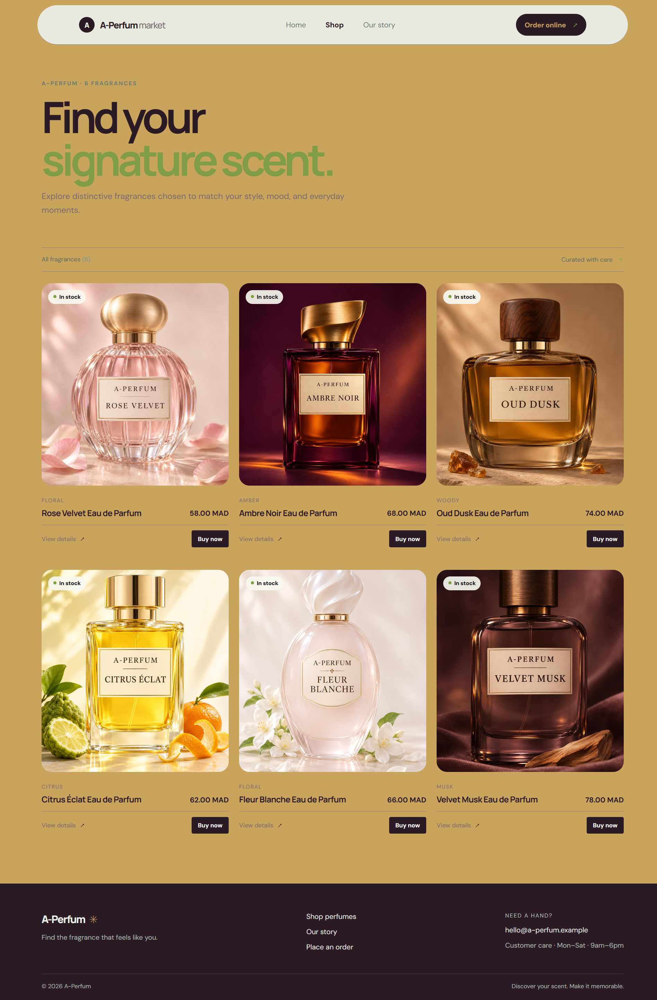
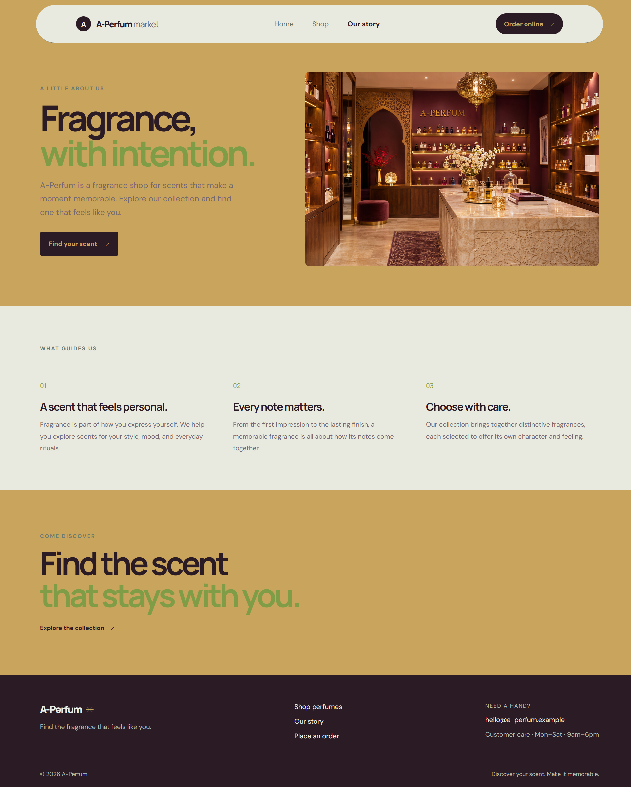
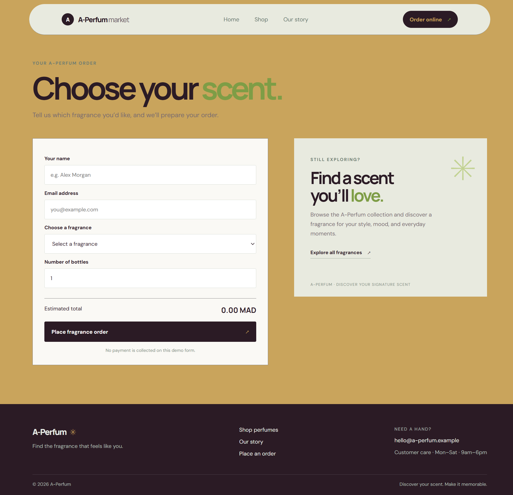

# A-Perfum — Discover Your Signature Scent

A-Perfum is a responsive perfume storefront concept for browsing a curated fragrance collection and placing a sample order. The site pairs a warm gold, cream, and plum palette with product photography and a simple shopping journey.

## Screenshots

### Home
The landing page introduces the store, highlights featured perfumes, and links visitors to the collection and brand story.


### Shop
Browse six fragrances with scent families, availability labels, prices in Moroccan dirhams (MAD), product details, and a Buy now action.



### Our story
Learn about the store’s approach to fragrance and explore the principles behind its curated collection.



### Order online
Enter contact details, choose a fragrance and bottle quantity, and review the estimated total before submitting the demo order form.



## Store pages and features

- **Home:** Brand introduction, featured fragrances, and links to shopping and the store story.
- **Shop:** Six perfume cards with names, scent families, stock status, prices, and product actions.
- **Our story:** Store information and the values guiding the fragrance selection.
- **Order online:** Customer name and email fields, fragrance selector, bottle quantity, and a live estimated total in MAD.
- **Shopping flow:** A product’s Buy now action can take the selected fragrance to the order form.
- **Responsive layout:** Pages are designed to adapt across desktop and smaller screens.
- **Demo form:** The order form is for demonstration; it does not collect payment.

## Technology

The storefront is built with React and Vite, uses React Router for page navigation, and uses CSS for styling. Product information is maintained as app data and displayed in reusable product cards.

## Run locally

You’ll need Node.js and npm installed.

```bash
# Install dependencies
npm install

# Start the development server
npm run dev
```

Open the local URL printed by Vite in your terminal.

## Production build

```bash
npm run build
npm run preview
```

The optimized site is written to the `dist/` directory.

## Project structure

```text

├── public
│   ├── favicon.svg
│   └── icons.svg
├── src
│   ├── assets
│   │   ├── img
│   │   │   ├── A-PERFUM-about.png
│   │   │   ├── A-PERFUM-hero.png
│   │   │   ├── perfume-1.png
│   │   │   ├── perfume-2.png
│   │   │   ├── perfume-3.png
│   │   │   ├── perfume-4.png
│   │   │   ├── perfume-5.png
│   │   │   └── perfume-6.png
│   │   ├── screenshots
│   │   │   ├── localhost_5173_.png
│   │   │   ├── localhost_5173_about.png
│   │   │   ├── localhost_5173_order.png
│   │   │   └── localhost_5173_products.png
│   │   └── videos
│   ├── components
│   │   ├── ProductCard.css
│   │   └── ProductCard.jsx
│   ├── layouts
│   │   ├── Footer.css
│   │   ├── Footer.jsx
│   │   ├── Header.css
│   │   └── Header.jsx
│   ├── pages
│   │   ├── About
│   │   │   ├── components
│   │   │   ├── About.css
│   │   │   └── About.jsx
│   │   ├── Error
│   │   │   ├── Error.css
│   │   │   └── Error.jsx
│   │   ├── Home
│   │   │   ├── components
│   │   │   ├── Home.css
│   │   │   └── Home.jsx
│   │   ├── PlaceOrder
│   │   │   ├── Components
│   │   │   ├── Order.css
│   │   │   └── Order.jsx
│   │   └── Store
│   │       ├── components
│   │       ├── Store.css
│   │       └── Store.jsx
│   ├── utils
│   │   └── Product.js
│   ├── App.css
│   ├── App.jsx
│   ├── index.css
│   └── main.jsx
├── .gitignore
├── .oxlintrc.json
├── README.md
├── index.html
├── package-lock.json
├── package.json
└── vite.config.js
```

Your exact source layout may vary; adjust the tree above if the project uses different folder names.

## Product collection

| Fragrance | Family | Price |
| --- | --- | ---: |
| Rose Velvet Eau de Parfum | Floral | 58 MAD |
| Ambre Noir Eau de Parfum | Amber | 68 MAD |
| Oud Dusk Eau de Parfum | Woody | 74 MAD |
| Citrus Éclat Eau de Parfum | Citrus | 62 MAD |
| Fleur Blanche Eau de Parfum | Floral | 66 MAD |
| Velvet Musk Eau de Parfum | Musk | 78 MAD |

## Notes

- Prices and stock labels are sample storefront data.
- No payment provider or backend order processing is shown in the supplied storefront screenshots.
- Update the product data and contact details in the source before using the site for a live store.

## What I’ll Present About Myself

Hello, my name is **[Ahmed Elmakrini]**. I’m a student and the creator of this A-Perfum storefront project. In this presentation, I’ll introduce the website, show how visitors can browse the fragrance collection and place a sample order, and explain the tools used to build it: React, Vite, React Router, and CSS. This project helped me practice building a responsive interface and organizing a simple shopping experience.

### 👨‍💻 Author

**Ahmed Elmakrini**

* **GitHub:** [@ahmed200-em](https://github.com/ahmed200-em)
* **Portfolio:** [Visit my portfolio](https://modern-portfolio-93c7xd0ub-ahmed200-ems-projects.vercel.app/)

## Thank You

Thank you for your time and attention. I hope you enjoyed discovering the A-Perfum storefront. I’m happy to answer any questions.
